# Relatório Acadêmico: Abstração, Identificação de Objetos e UML
## Estudo de Caso: Sistema de Gestão de Estacionamento

**Disciplina:** Programação Orientada a Objetos / Engenharia de Software  
**Grupo 3:** Mariah M.; Vinicius S.; Alan G.; Bernardo R.  
**Data da Apresentação:** 24/09/2026 às 19h30min  

---

## 1. Descrição do Problema e Abstração do Domínio (Tarefa 1)

### 1.1 Contextualização do Problema
O objetivo do sistema é gerenciar as operações rotineiras de um estacionamento comercial privativo. O negócio necessita:
- Controlar a ocupação de vagas físicas setorizadas (carros, motos, utilitários/caminhonetes).
- Registrar a entrada e saída dos veículos de forma rápida e segura.
- Garantir que nenhum veículo entre sem que haja vaga adequada disponível.
- Medir a duração exata da permanência e calcular a tarifa a ser cobrada.
- Fornecer relatórios gerenciais simples sobre ocupação e faturamento.

### 1.2 O Papel da Abstração na Modelagem
A **Abstração** é um dos quatro pilares fundamentais da Orientação a Objetos. Trata-se do mecanismo cognitivo de concentrar-se nas propriedades essenciais de uma entidade do mundo real sob a perspectiva do sistema que se deseja construir, ignorando deliberadamente detalhes acidentais ou irrelevantes.

No mundo físico, um veículo e um estacionamento possuem centenas de propriedades. No entanto, para o software de controle de vagas e cobrança, a inclusão de dados supérfluos aumentaria o acoplamento, o custo de desenvolvimento e a complexidade de manutenção.

| Elementos Essenciais (Incluídos no Modelo) | Justificativa no Domínio do Sistema | Detalhes Descartados (Ignorados pela Abstração) | Por que foram descartados? |
| :--- | :--- | :--- | :--- |
| **Placa do Veículo** | Identificador unívoco legal do veículo para registro e segurança. | **Cor e Pintura do Veículo** | Irrelevante para o cálculo de tarifa e ocupação da vaga. |
| **Modelo do Veículo** | Facilita a identificação visual pelo operador do pátio. | **Quilometragem e Nível de Combustível** | Não afetam o serviço prestado pelo estacionamento. |
| **Tipo/Categoria do Veículo** | Define a compatibilidade com a vaga e o multiplicador da tarifa. | **Estado dos Pneus e Mecânica** | Responsabilidade exclusiva do proprietário. |
| **Número da Vaga** | Identificador físico da posição no pátio para localização ágil. | **Material do Piso / Pintura das Faixas** | Detalhe de infraestrutura civil sem impacto lógico. |
| **Estado da Vaga (Livre/Ocupada)**| Controle de capacidade e disponibilidade em tempo real. | **Câmeras de Segurança e Iluminação** | Pertencem a subsistemas de CFTV/elétrica independentes. |
| **Data/Hora de Entrada e Saída** | Variável primordial para cômputo da permanência e cobrança. | **Dados Pessoais do Condutor (CPF, RG)** | Desnecessários para estacionamento rotativo avulso (privacidade e LGPD). |
| **Tarifa Base e Multiplicadores** | Regra financeira que determina o valor devido pelo serviço. | **Forma de Pagamento Interna do Banco** | Integração bancária é detalhe secundário externo. |

---

## 2. Definição Formal das Classes, Atributos e Responsabilidades (Tarefa 2)

Seguindo o **Princípio da Responsabilidade Única (Single Responsibility Principle - SRP)**, cada classe foi desenhada com um propósito bem delimitado:

### 2.1 Enumeração `TipoVeiculo`
- **Responsabilidade:** Padronizar as categorias aceitas no estacionamento e manter seus respectivos fatores de ponderação na tarifa.
- **Constantes:** `CARRO` (fator 1.0), `MOTO` (fator 0.5), `CAMINHONETE` (fator 1.2).
- **Atributos:** `descricao: String`, `multiplicadorTarifa: double`.
- **Métodos:** `getDescricao()`, `getMultiplicadorTarifa()`.

### 2.2 Classe `Veiculo`
- **Responsabilidade:** Representar a entidade de transporte que usufrui das instalações do estacionamento.
- **Atributos:**
  - `placa: String` (privado, obrigatório, formatado em caixa alta).
  - `modelo: String` (privado, ex: "Toyota Corolla").
  - `tipo: TipoVeiculo` (privado, associação com o enum).
- **Métodos:** Construtor validador, getters/setters protegidos, `equals()` e `hashCode()` baseados na placa (chave de negócio) e `toString()`.

### 2.3 Classe `Vaga`
- **Responsabilidade:** Gerenciar o espaço físico de parada, garantindo que apenas um veículo compatível estacione por vez.
- **Atributos:**
  - `numero: int` (identificador numérico sequencial da vaga).
  - `tipoPermitido: TipoVeiculo` (restrição física da vaga).
  - `ocupada: boolean` (indicador de estado booleano).
  - `veiculoEstacionado: Veiculo` (referência ao veículo que atualmente ocupa a vaga, ou `null`).
- **Métodos:**
  - `isDisponivel(): boolean` (verifica se está desocupada).
  - `isCompativel(TipoVeiculo): boolean` (valida se o veículo cabe na vaga).
  - `ocupar(Veiculo): void` (efetua a reserva física com validações rigorosas).
  - `desocupar(): Veiculo` (libera a vaga e retorna o veículo removido).
  - Getters e `toString()`.

### 2.4 Classe `Ticket`
- **Responsabilidade:** Representar o contrato de serviço e o registro temporal/financeiro da permanência de um veículo em uma vaga específica.
- **Atributos:**
  - `id: String` (código único de controle, ex: "TCK-1001").
  - `veiculo: Veiculo` (referência ao veículo atendido).
  - `vaga: Vaga` (referência à vaga utilizada).
  - `dataHoraEntrada: LocalDateTime` (registro temporal de início).
  - `dataHoraSaida: LocalDateTime` (registro temporal de término).
  - `valorCobrado: double` (valor final apurado).
  - `encerrado: boolean` (flag de ciclo de vida).
- **Métodos:**
  - `calcularMinutosPermanencia(LocalDateTime): long`
  - `calcularValor(LocalDateTime, double tarifaBase): double` (implementa regras de tolerância de 15 minutos e arredondamento comercial de horas).
  - `encerrar(LocalDateTime, double tarifaBase): double`
  - `gerarComprovante(): String` (formata o recibo final de pagamento).

### 2.5 Classe `Estacionamento`
- **Responsabilidade:** Fachada (Facade) e controladora central das regras de negócio do estacionamento.
- **Atributos:**
  - `nome: String`
  - `tarifaBaseHora: double`
  - `vagas: List<Vaga>`
  - `ticketsAtivos: Map<String, Ticket>` (acesso O(1) por placa)
  - `historicoTickets: List<Ticket>`
- **Métodos:**
  - `registrarEntrada(Veiculo): Ticket`
  - `registrarSaida(String placa): Ticket`
  - `consultarVagasDisponiveis(): List<Vaga>`
  - `consultarVagasOcupadas(): List<Vaga>`
  - `getFaturamentoTotal(): double`
  - `gerarRelatorioOcupacao(): String`

---

## 3. Diagrama de Classes UML (Tarefa 3)

O diagrama abaixo ilustra a estrutura das classes, sua visibilidade, seus atributos e as relações de associação, agregação e composição:

```mermaid
classDiagram
    direction TB

    class TipoVeiculo {
        <<enumeration>>
        CARRO
        MOTO
        CAMINHONETE
        -descricao : String
        -multiplicadorTarifa : double
        +getDescricao() : String
        +getMultiplicadorTarifa() : double
    }

    class Veiculo {
        -placa : String
        -modelo : String
        -tipo : TipoVeiculo
        +Veiculo(placa : String, modelo : String, tipo : TipoVeiculo)
        +getPlaca() : String
        +setPlaca(placa : String) : void
        +getModelo() : String
        +setModelo(modelo : String) : void
        +getTipo() : TipoVeiculo
        +setTipo(tipo : TipoVeiculo) : void
        +equals(o : Object) : boolean
        +hashCode() : int
        +toString() : String
    }

    class Vaga {
        -numero : int
        -tipoPermitido : TipoVeiculo
        -ocupada : boolean
        -veiculoEstacionado : Veiculo
        +Vaga(numero : int, tipoPermitido : TipoVeiculo)
        +isDisponivel() : boolean
        +isCompativel(tipo : TipoVeiculo) : boolean
        +ocupar(veiculo : Veiculo) : void
        +desocupar() : Veiculo
        +getNumero() : int
        +getTipoPermitido() : TipoVeiculo
        +isOcupada() : boolean
        +getVeiculoEstacionado() : Veiculo
        +toString() : String
    }

    class Ticket {
        -id : String
        -veiculo : Veiculo
        -vaga : Vaga
        -dataHoraEntrada : LocalDateTime
        -dataHoraSaida : LocalDateTime
        -valorCobrado : double
        -encerrado : boolean
        +Ticket(id : String, veiculo : Veiculo, vaga : Vaga, entrada : LocalDateTime)
        +calcularMinutosPermanencia(momentoFinal : LocalDateTime) : long
        +calcularValor(momentoFinal : LocalDateTime, tarifaBase : double) : double
        +encerrar(saida : LocalDateTime, tarifaBase : double) : double
        +getId() : String
        +getVeiculo() : Veiculo
        +getVaga() : Vaga
        +getDataHoraEntrada() : LocalDateTime
        +getDataHoraSaida() : LocalDateTime
        +getValorCobrado() : double
        +isEncerrado() : boolean
        +getEntradaFormatada() : String
        +getSaidaFormatada() : String
        +gerarComprovante() : String
        +toString() : String
    }

    class Estacionamento {
        -nome : String
        -tarifaBaseHora : double
        -vagas : List~Vaga~
        -ticketsAtivos : Map~String, Ticket~
        -historicoTickets : List~Ticket~
        -proximoNumeroTicket : int
        +Estacionamento(nome : String, tarifaBaseHora : double)
        +adicionarVaga(vaga : Vaga) : void
        +inicializarVagasPadrao() : void
        +registrarEntrada(veiculo : Veiculo) : Ticket
        +registrarEntrada(veiculo : Veiculo, entrada : LocalDateTime) : Ticket
        +registrarSaida(placa : String) : Ticket
        +registrarSaida(placa : String, saida : LocalDateTime) : Ticket
        +consultarVagasDisponiveis() : List~Vaga~
        +consultarVagasOcupadas() : List~Vaga~
        +consultarVagasDisponiveisPorTipo(tipo : TipoVeiculo) : List~Vaga~
        +buscarTicketAtivo(placa : String) : Optional~Ticket~
        +getFaturamentoTotal() : double
        +gerarRelatorioOcupacao() : String
        +getVagas() : List~Vaga~
        +getTicketsAtivos() : Collection~Ticket~
        +getHistoricoTickets() : List~Ticket~
    }

    %% Relacionamentos
    Veiculo --> "1" TipoVeiculo : possui
    Vaga --> "1" TipoVeiculo : restrita a
    Vaga "1" o-- "0..1" Veiculo : abriga

    Ticket --> "1" Veiculo : referencia
    Ticket --> "1" Vaga : referencia

    Estacionamento "1" *-- "1..*" Vaga : contem
    Estacionamento "1" *-- "0..*" Ticket : gerencia
```

### 3.1 Justificativa das Relações UML
1. **Composição (`Estacionamento *-- Vaga`):** As vagas físicas compõem o estacionamento. Se o estacionamento for destruído no sistema, suas vagas deixam de existir contextualmente. Multiplicidade: `1` para `1..*`.
2. **Composição (`Estacionamento *-- Ticket`):** Os tickets emitidos e o histórico financeiro pertencem intrinsecamente ao controle daquele estacionamento.
3. **Agregação (`Vaga o-- Veiculo`):** A vaga abriga temporariamente de 0 a 1 veículo. Essa é uma relação de agregação fraca, pois o `Veiculo` possui ciclo de vida independente: antes de entrar e após sair do estacionamento, o veículo continua existindo no mundo real e na memória do programa.
4. **Associação Simples (`Ticket --> Veiculo` e `Ticket --> Vaga`):** O ticket referencia o veículo atendido e a vaga ocupada para emissão do extrato e auditoria.

---

## 4. Implementação em Java (Tarefa 4)

A implementação foi codificada em Java moderno, seguindo as melhores práticas da linguagem:
- **Organização modular por pacotes:**
  - `br.com.estacionamento.model`: Classes de domínio e entidades puras (`Veiculo`, `Vaga`, `Ticket`, `TipoVeiculo`).
  - `br.com.estacionamento.service`: Lógica de negócio e orquestração (`Estacionamento`).
  - `br.com.estacionamento.app`: Ponto de entrada com console interativo e simulador (`Main`).
- **Encapsulamento estrito:** Atributos declarados como `private` ou `final`, com métodos de leitura (`getters`) e regras de integridade nos métodos de alteração.
- **Manipulação de Tempo Precisa:** Utilização do pacote `java.time` (`LocalDateTime` e `Duration`) em substituição às classes legadas e problemáticas `Date` e `Calendar`.
- **Coleções e Streams:** Uso de `List`, `Map` e a API de `Streams` para consultas declarativas e funcionais sobre as vagas e histórico.
- **Duplo modo de uso:**
  1. *Menu Interativo:* Permite testar manualmente as entradas e saídas de novos veículos.
  2. *Modo Demonstração Automática (Opção 6):* Executa um cenário predefinido completo em menos de 10 segundos, ideal para o momento da apresentação.

---

## 5. Comparação UML vs. Código e Redução da Complexidade (Tarefa 5)

### 5.1 Correspondência entre o Modelo UML e o Código Java
Ao comparar o diagrama UML com o código Java produzido, verifica-se uma conformidade direta:
1. **Atributos e Modificadores:** Os símbolos de visibilidade UML (`-` para privado, `+` para público) foram traduzidos diretamente em palavras-chave Java (`private`, `public`).
2. **Relacionamentos e Coleções:** A relação `1..*` entre `Estacionamento` e `Vaga` se manifestou no código como `private final List<Vaga> vagas`.
3. **Associações Direcionadas:** A referência de `Ticket` para `Veiculo` traduziu-se no atributo `private final Veiculo veiculo`.

### 5.2 Como a Abstração Reduziu a Complexidade do Problema
O exercício prático comprovou os benefícios fundamentais da Abstração no ciclo de vida de desenvolvimento:

1. **Redução da Carga Cognitiva:**
   Ao decidirmos ignorar a cor do carro, o nome do motorista, a pressão dos pneus ou o fornecedor da catraca eletrônica, focamos exclusivamente nas variáveis que importam para o negócio: **placa, categoria e tempo**. Isso reduziu o tamanho das classes em mais de 70%, tornando o código compreensível e livre de ruído.

2. **Divisão de Responsabilidades e Baixo Acoplamento:**
   A classe `Veiculo` não sabe o que é uma vaga nem quanto custa o estacionamento. A classe `Vaga` não sabe quanto tempo o veículo ficou estacionado. Quem cuida da tarifa é o `Ticket` e quem orquestra a entrada/saída é o `Estacionamento`. Essa separação impede o surgimento de "classes deus" (God Classes) e torna o sistema modular.

3. **Facilidade de Extensão (Princípio Aberto/Fechado):**
   Se no futuro o estacionamento decidir aceitar **Caminhões** ou conceder desconto para **Veículos Elétricos**, basta adicionar um novo elemento ao enum `TipoVeiculo` ou criar uma nova regra de cálculo, sem alterar a estrutura básica de `Vaga` ou `Estacionamento`.

4. **Previsibilidade e Qualidade de Software:**
   Desenhar o diagrama UML antes da codificação evitou refatorações desnecessárias durante o desenvolvimento em Java. Os limites de cada classe já estavam claros antes da primeira linha de código ser escrita.

---

## 6. Conclusão do Grupo
A modelagem orientada a objetos permitiu que o Grupo 3 transformasse um problema do cotidiano (estacionamento) em um modelo computacional elegante, modular e escalável. O diagrama UML serviu como o elo de comunicação perfeito entre a análise do problema e a implementação em Java, demonstrando na prática o poder da Abstração e do Encapsulamento na engenharia de software moderna.
